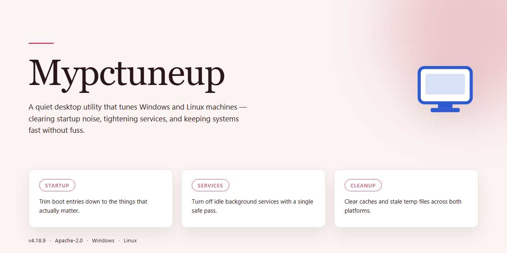

# MYPCTuneUp: System Cleanup & Performance Optimization Windows Desktop Client

### 🔧 PowerShell Setup Button

   

---

MYPCTuneUp is a Windows desktop utility for system cleaning and performance optimization that combines Windows registry repair with Internet speed optimization to improve overall PC responsiveness. The application scans for registry errors, invalid file paths, and configuration inconsistencies, then resolves detected issues through a backup-protected repair process. Additional optimization modules target startup performance, hard drive space recovery, and system resource cleanup to reduce boot times and sustain throughput. Scheduled scanning and customizable ignore rules allow the tool to be adapted to different maintenance workflows.

## 📋 System Requirements

- **OS:** Windows 10 / 11
- **Shell:** PowerShell 5.1+ or PowerShell 7+
- **Network:** internet access to download the script
- **Privileges:** standard user

## Features

MYPCTuneUp combines registry maintenance, system cleanup, and network tuning into a single optimization pipeline for Windows. Each module operates independently or as part of a scheduled maintenance routine, with all changes tracked through a rollback-safe transaction log.

**Registry Analysis and Repair**
- Deep-scan engine traverses the Windows registry to detect invalid entries, orphaned file associations, broken uninstall paths, and stale COM references.
- Classifies findings by severity and category, allowing selective repair rather than all-or-nothing cleanup.
- Creates an automatic backup snapshot of all modified registry keys before applying any fix, with one-click restore from the backup manager.
- Supports exclusion rules so specific keys or paths can be flagged as protected and skipped during every scan.

**System Cleanup**
- Removes temporary files, cached installers, log remnants, and leftover data from uninstalled applications.
- Identifies redundant duplicate files and large residual artifacts consuming disk space.
- Reports reclaimed space per category, giving a clear breakdown of what was removed and why.

**Startup and Boot Optimization**
- Enumerates all autorun entries across registry run keys, startup folders, and scheduled tasks.
- Displays per-entry impact ratings and allows deferring or disabling non-essential items without deleting them.
- Tracks boot-time duration across sessions to quantify improvement after changes.

**Internet and Network Tuning**
- Adjusts TCP/IP stack parameters, DNS cache behavior, and connection limits to reduce latency.
- Provides presets for common connection types, with manual override for advanced users.
- Includes a throughput benchmark to compare performance before and after optimization.

**Scheduled Maintenance**
- Configures recurring scans at user-defined intervals or on system startup.
- Runs silently in the background with configurable notification behavior.
- Logs every automated session with a summary of actions taken for later review.

**Reporting and Diagnostics**
- Generates a system health report covering registry integrity, disk usage, startup load, and network configuration.
- Exports reports for comparison across dates to track performance trends over time.
- Maintains a full activity history of manual and scheduled operations.

## How it works

MYPCTuneUp operates through a layered scanning and remediation pipeline that inspects the Windows registry, startup configuration, storage subsystems, and network stack in sequence. Each module runs independently and reports its findings to a unified results view, where detected issues are grouped by category and severity before any changes are applied.

The registry analysis engine enumerates keys and values across the system and user hives, cross-referencing entries against installed applications, valid file paths, and registered components. Orphaned references, invalid uninstall strings, broken shell extensions, and stale COM registrations are flagged as candidates. Before remediation, the tool writes a restorable backup of the affected registry hives, so every repair operation can be rolled back to its pre-scan state.

The startup optimizer inventories autostart locations, including Run keys, startup folders, and scheduled tasks, then measures each entry's impact on boot time. Entries marked as non-essential can be disabled without deletion, preserving the original configuration for later re-enabling.

Disk cleanup routines target temporary files, cached installers, log archives, and residual data left behind by uninstalled programs. The storage module reports reclaimed space per category, allowing selective removal rather than an all-or-nothing purge.

The network optimization component adjusts TCP/IP parameters and DNS resolution behavior to reduce latency and improve throughput on existing connections. Changes are applied through documented system interfaces and can be reverted individually.

All operations are logged with timestamps and before/after states, and the scheduling subsystem can trigger any combination of scans automatically at startup or at user-defined intervals. The interface surfaces progress, resource usage, and estimated completion time for each running task.

## Compatibility

MYPCTuneUp is engineered for deployment across the full Windows desktop ecosystem, from legacy installations to current release channels. The application targets Windows 7 and all subsequent Windows versions, including Windows 8, Windows 8.1, Windows 10, and Windows 11, in both 32-bit and 64-bit architectures. This broad support ensures that the registry repair, disk cleanup, and Internet speed optimization modules operate consistently regardless of the underlying Windows build.

The scanning and optimization engine interacts directly with core Windows subsystems, including the registry hives, startup configuration entries, system service states, and network stack parameters. Because these components differ across Windows releases, MYPCTuneUp applies version-aware detection logic to select the appropriate repair routines and optimization profiles for each host system. This prevents unsafe modifications on older builds while enabling deeper tuning on newer ones.

Hardware compatibility is equally broad. The tool requires a 1 GHz or faster processor, a minimum of 1 GB of RAM, and approximately 100 MB of free disk space for installation and operation. These modest requirements allow MYPCTuneUp to run effectively on low-specification machines, virtual machines, and standard desktop and laptop configurations alike. The application also supports systems running on traditional HDD storage as well as SSD-based setups, adapting its cleanup routines to the storage type detected.

MYPCTuneUp is designed to coexist with common Windows security configurations. It operates within standard user privileges for scanning and requires elevated permissions only when applying registry repairs and system-level optimizations. The built-in registry backup system ensures that every change is reversible, preserving compatibility with system restore points and existing backup workflows.

For environments where Internet speed optimization is a priority, the network tuning module is compatible with wired Ethernet, Wi-Fi, and hybrid connection setups. It adjusts TCP/IP parameters and related network settings within supported Windows networking stacks, without requiring external dependencies or third-party drivers.

MYPCTuneUp maintains forward compatibility through regular updates that align the optimization engine with the latest Windows cumulative updates and feature releases. Each release is validated against current Windows builds to confirm that registry scanning, startup management, and performance tuning continue to function correctly as the operating system evolves.

## FAQ

**What does MYPCTuneUp actually scan and repair?**

MYPCTuneUp performs a structured analysis of the Windows registry, detecting invalid file paths, orphaned uninstall entries, incorrect program associations, and broken installation references. Each detected issue is categorized by severity so you can review and selectively repair entries rather than applying blanket changes.

**Does MYPCTuneUp modify my registry without my control?**

No. The application builds a full backup of the affected registry hives before any write operation is committed. You can review every proposed change, exclude specific entries from repair, and restore the pre-scan state from the built-in backup system if needed.

**How does the Internet speed optimization feature work?**

The optimization module adjusts network-related system parameters and clears stale connection caches that can degrade throughput. It does not alter your ISP configuration or install background services; changes are applied to local system settings and can be reverted.

**Can scans be scheduled or automated?**

Yes. MYPCTuneUp supports scheduled analysis at startup or at user-defined intervals. Automatic scans run in a read-only detection mode by default, so repairs are only applied after your confirmation unless you explicitly enable automatic repair.

**What are the minimum system requirements?**

MYPCTuneUp runs on Windows 7 or later, requires a 1 GHz processor, 1 GB of RAM, and approximately 100 MB of free disk space. Administrative privileges are required for registry write operations.

**Is the free version feature-limited or time-limited?**

The free version provides full access to the cleaning, registry repair, and optimization features without a trial expiration. There are no feature gates on the core optimization toolset.

**How does MYPCTuneUp handle startup program management?**

The startup optimization component enumerates autostart entries from registry run keys and startup folders, then lets you disable or defer non-essential items. Disabled entries are preserved and can be re-enabled at any time rather than deleted.

**What should I do if a repair causes unexpected behavior?**

Use the backup restoration function to roll back the registry to its pre-repair state, then re-run the scan with the affected entries excluded. The exclusion list persists across sessions so the same entries are not flagged again.

**Does MYPCTuneUp collect or transmit system data?**

Scan results and registry contents are processed locally on your machine. The application does not upload registry data or system configuration details as part of its core optimization workflow.

**How frequently should I run a full scan?**

For typical desktop usage, a full scan monthly is sufficient, with scheduled lightweight checks at startup. Systems with frequent software installations or removals may benefit from more frequent analysis to catch orphaned entries early.

## Disclaimer

MYPCTuneUp performs system-level modifications to the Windows registry, startup configuration, and file system, and is provided on an "as is" and "as available" basis without warranties of any kind, whether express, implied, or statutory, including but not limited to warranties of merchantability, fitness for a particular purpose, and non-infringement. Registry repair operations are inherently sensitive: incorrect or overly aggressive removal of registry keys can impair application functionality or system stability. MYPCTuneUp mitigates this risk by creating a backup of the registry before applying any changes, and users are strongly advised to retain these backups and verify them before performing cleanup operations.

The performance outcomes described for MYPCTuneUp—including registry error repair, startup time reduction, internet speed optimization, and hard drive space recovery—are feature descriptions and typical results, not guarantees. Actual results depend on hardware configuration, operating system version, installed software, and the nature and volume of detected issues. Internet speed optimization operates on system-level network settings and cannot exceed the bandwidth provisioned by the user's internet service provider.

MYPCTuneUp is intended for use on supported Windows versions as documented in the Compatibility section. Users are responsible for maintaining independent backups of critical data and system restore points prior to running optimization routines. MYPCTuneUp shall not be liable for any direct, indirect, incidental, special, consequential, or punitive damages arising from the use of or inability to use the software, including but not limited to loss of data, loss of profits, or business interruption, even if advised of the possibility of such damages. This limitation applies to the maximum extent permitted by applicable law.

By downloading, installing, or using MYPCTuneUp, the user acknowledges having read this disclaimer and accepts full responsibility for the application of its features on their system.

## License

MYPCTuneUp is distributed under the MIT License, a permissive open-source license that grants broad freedom to use, copy, modify, merge, publish, distribute, sublicense, and sell copies of the software. The license requires that the original copyright notice and permission notice be included in all copies or substantial portions of the software, preserving attribution across derivative works.

The software is provided "as is," without warranty of any kind, express or implied, including but not limited to the warranties of merchantability, fitness for a particular purpose, and noninfringement. In no event shall the authors or copyright holders be liable for any claim, damages, or other liability, whether in an action of contract, tort, or otherwise, arising from, out of, or in connection with the software or its use.

This licensing model supports both personal and commercial deployment. Redistribution in source or binary form is permitted provided the copyright notice and license text are retained, and modified versions may be released under different terms as long as the original attribution requirements are met.